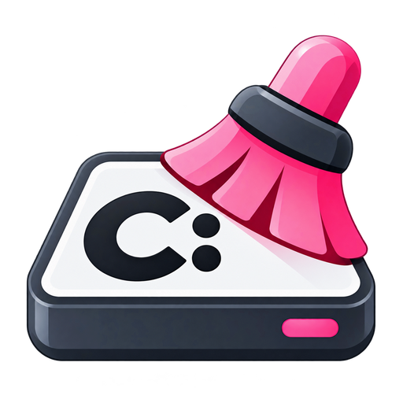

<div align="center">



# Safe C: Cleaner

**Безопасная очистка Windows и анализ дискового пространства**

Windows 10/11 · .NET 10 · WinUI 3 · Версия **0.6.0**

[**Скачать последнюю версию**](https://github.com/CactusDex/Safe-C-Cleaner/releases/latest) · [История изменений](CHANGELOG.md) · [Документация](Info/ROADMAP.md)

</div>

---

## О приложении

**Safe C: Cleaner** — настольная утилита для анализа занятого пространства на диске `C:`, контролируемой очистки временных данных Windows и работы с кэшами инструментов разработки.

Приложение отделяет анализ от удаления: найденные большие файлы и папки можно изучать без автоматической очистки. Операции, затрагивающие систему, выполняются через предусмотренные средства Windows и с необходимыми подтверждениями.

## Возможности

| Раздел | Возможности |
| --- | --- |
| **Обзор** | Состояние системного диска, доступное пространство, результаты последних проверок. |
| **Быстрая очистка** | Выборочная очистка поддерживаемых временных файлов и кэшей; просмотр категорий и предполагаемого объёма. |
| **Глубокая очистка** | Отдельные системные операции, в том числе обслуживание хранилища компонентов Windows через штатные средства. |
| **Диск и рост** | Снимки использования пространства, сравнение изменений за разные периоды и разбор каталогов. |
| **Анализатор диска** | Поиск крупных файлов и папок, фильтрация по типу, размеру и возрасту, сортировка, отмена анализа. **Без удаления найденных файлов.** |
| **Developer Storage** | Анализ данных Docker, WSL, npm, NuGet и Android SDK; доступные операции зависят от инструмента и выполняются выборочно. |
| **История очисток** | Просмотр результатов операций и экспорт доступных отчётов. |
| **Обновления** | Проверка стабильных версий через GitHub Releases в разделе «О программе»; встроенная загрузка установщика с проверкой целостности. |

Дополнительно доступны системный трей, настраиваемый автозапуск и режим одного экземпляра приложения.

## Безопасность

- **PathGuard и списки разрешённых операций** ограничивают действия очистки.
- **Elevated Helper** выполняет только предусмотренные привилегированные операции с запросом UAC.
- **Storage Analyzer** и просмотр результатов Storage Intelligence не удаляют обнаруженные файлы автоматически.
- Docker volumes и дистрибутивы WSL не удаляются автоматически.
- Приложение **не содержит** Registry Cleaner, дефрагментации и «оптимизатора RAM».
- Загрузка обновления не означает его автоматический запуск: установка остаётся под контролем пользователя.

Подробности: [модель безопасности](Info/SECURITY.md).

## Что нового в 0.6.0

- Исправлена компоновка прогресса сканирования: длинные пути больше не должны менять размеры элементов интерфейса.
- Снижена частота обновления прогресса в UI.
- Добавлена проверка версий через GitHub Releases и встроенный Update Manager.
- Добавлены сценарии `GITHUB-PUSH.cmd` и `GITHUB-RELEASE.cmd` для сопровождения репозитория и подготовки релизов.
- Исправлены отдельные проблемы сценариев сборки и подготовки установщика.

Полная история версий: [CHANGELOG.md](CHANGELOG.md).

## Установка

1. Откройте [последний релиз Safe C: Cleaner](https://github.com/CactusDex/Safe-C-Cleaner/releases/latest).
2. Скачайте установщик `SafeCCleaner-Setup-<версия>.exe` из раздела **Assets**.
3. Запустите установщик и следуйте инструкциям.

При обновлении поверх предыдущей версии используется тот же идентификатор приложения Inno Setup. Перед обновлением рекомендуется закрыть Safe C: Cleaner, включая значок в системном трее.

> Установщик рассчитан на Windows x64. Релизная сборка включает необходимый .NET runtime и Windows App SDK; отдельная установка .NET для запуска готового приложения не требуется.

## Сборка из исходников

**Требования для разработки:** Windows 10/11, .NET 10 SDK и инструменты сборки, необходимые для WinUI 3. Для формирования установщика нужен Inno Setup 6.

В корне клонированного проекта запустите:

```bat
BUILD-WINDOWS.cmd
```

Для сборки установщика:

```bat
BUILD-INSTALLER.cmd
```

Результаты сборки сохраняются в `artifacts/` и не предназначены для включения в Git-коммиты. Для работы с Git предусмотрены отдельные `GITHUB-PUSH.cmd` и `GITHUB-RELEASE.cmd`; перед публикацией проверяйте состав изменений и результаты тестирования.

## Документация

- [История изменений](CHANGELOG.md)
- [План развития](Info/ROADMAP.md)
- [Принципы безопасности](Info/SECURITY.md)
- [Проверки v0.6.0](Info/TEST-0.6.0.md)
- [Сведения о Windows-сборке](Info/WINDOWS-APP.md)

## Разработчик

**Cactus Dex**

Репозиторий: [github.com/CactusDex/Safe-C-Cleaner](https://github.com/CactusDex/Safe-C-Cleaner)

> Информация о лицензии будет размещена отдельно после выбора условий распространения. Наличие публичного исходного кода само по себе не означает предоставление разрешения на его свободное использование или распространение.
